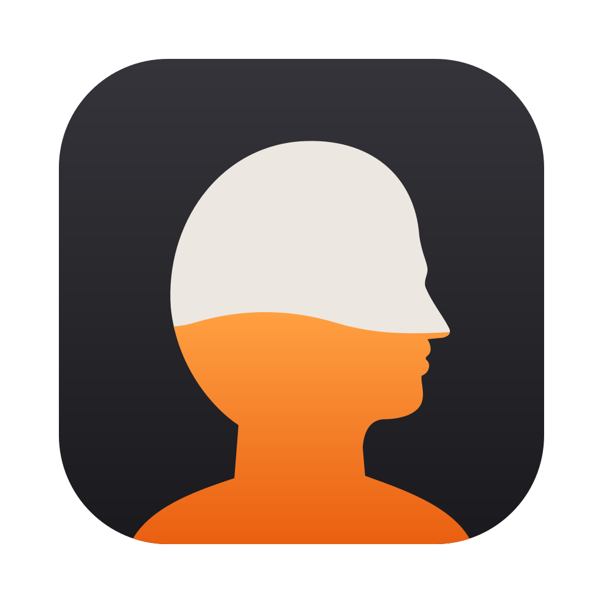
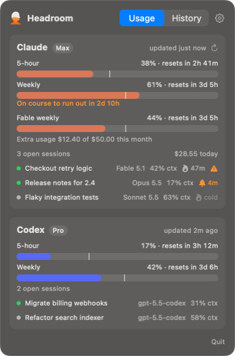
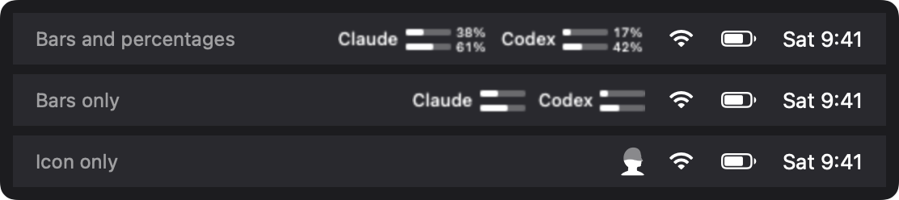
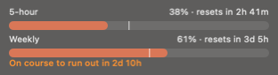
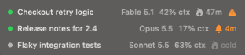
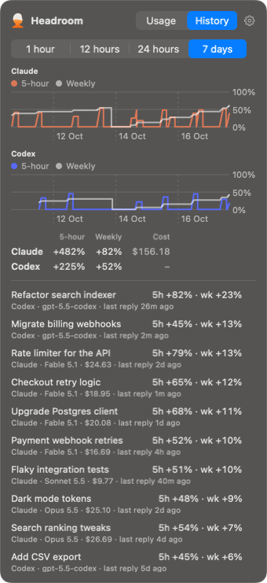

# Headroom

A macOS menu bar app that shows how much of your Claude plan's limits you've used, for
every Claude Code account on your Mac at once. More at
[dpurdy.me/apps/headroom](https://dpurdy.me/apps/headroom/).



- **5-hour and weekly limits** per account, with reset countdowns. The menu bar shows one
  column per account: its label beside two small bars with percentages, 5-hour on top and
  weekly below. Settings chooses which accounts appear there, and whether to show bars and
  percentages, bars only, or just an icon.

  
- **Pace** for each limit: a line showing how much of the window has passed, and when you'd
  run out if you carry on at the rate so far.

  
- **Open Claude Code sessions** per account, with model and context used. Sessions that
  haven't replied for 15 minutes are marked idle.
- **Prompt cache countdown** per session: how long until the conversation's cache goes cold,
  after which the next message re-reads the whole conversation at full price. Click it to be
  notified 5 minutes before a 1-hour cache goes cold, or 2 before a 5-minute one; hover a
  session to see which it has. A warning marks a session whose cache missed in the last hour,
  with Claude Code's guess at why. Needs Claude Code 2.1.251 or later.

  
- **Usage alerts** (optional): a notification when a limit passes 80% or 90%, and again when
  it resets.
- **Today's API-equivalent cost** per account, as estimated by Claude Code. It is not what
  your subscription bills.
- **History** for the last 1, 12 or 24 hours or 7 days: a chart of each account's 5-hour and
  weekly usage, and the conversations with replies in that time, with how much of each limit
  they used.

  
- **Optional Live usage** per account, which also catches use from claude.ai, the desktop
  app and other devices, and adds what claude.ai's usage page shows beyond the two limits: a
  model's own weekly limit (such as Fable's), your extra usage this month, and where this
  week's usage went.
- **Codex** (optional): the same 5-hour and weekly bars, pace, open sessions and History for
  each OpenAI Codex account, read from Codex's own session logs.
- **Update notifications**: Headroom checks GitHub for a new release once a day, and can
  install it from the menu.

## Requirements

- macOS 14 (Sonoma) or later.
- [Claude Code](https://code.claude.com) installed and logged in on the Mac with a Claude
  subscription (Pro, Max or Team). Headroom reads usage through Claude Code, so if you only
  use claude.ai or the desktop app, it has nothing to show.

## Install

```sh
curl -fsSL https://raw.githubusercontent.com/DanPurdy/headroom/main/scripts/install.sh | bash
```

That downloads the latest release into `/Applications` (or `~/Applications`) and opens it.

Or download `Headroom-x.y.z.zip` from [Releases](https://github.com/DanPurdy/headroom/releases)
and move `Headroom.app` to Applications. Releases aren't signed with an Apple Developer ID
yet, so macOS blocks a browser download the first time you open it. Either approve it in
System Settings → Privacy & Security → Open Anyway, or run
`xattr -dr com.apple.quarantine /Applications/Headroom.app`.

## Set up

The first time Headroom opens, a setup guide walks you through it: the accounts it found,
what connecting each one does, Live usage, what everything in the menu means, and alerts.
Skip it if you like; it's under **Setup guide…** in Settings. To set up by hand:

1. Click the gauge in the menu bar, then the **gear** to open Settings.
2. Headroom lists `~/.claude` and every `~/.claude-*` folder. Each Claude Code folder (the
   one `CLAUDE_CONFIG_DIR` points at, or `~/.claude` by default) is one account. If yours
   lives somewhere else, use **Add folder…**.
3. Give each a label and press **Connect**. Press Return in the label field to rename it
   later.
4. Send a message in Claude Code on that account. Its usage appears straight away.
5. Optionally switch on **Live usage** for an account (see below), **Launch at login** and
   **Usage alerts**.
6. Under **Menu bar**, untick accounts you don't need in the menu bar, or switch to **Bars
   only** or **Icon only** to keep it small. The dropdown always shows every account.
7. For Codex, press **Track** on a folder under **Codex accounts** (see below).

**Connect** edits the `statusLine` setting in that folder's `settings.json` so Headroom sees
each reply. Your existing status line keeps working exactly as before. A copy of the
original `settings.json` is kept in `~/Library/Application Support/Headroom/installs`, and
**Remove** puts the original setting back.

## How it works

Claude Code passes your plan usage (`rate_limits`) to its
[status line command](https://code.claude.com/docs/en/statusline) after every reply.
Headroom wraps that command: it saves the figures to small JSON files in
`~/Library/Application Support/Headroom`, then runs your original status line with the same
input. The status line runs locally and uses no tokens. Without Live, Headroom never touches
your login or calls Anthropic. Its only network request is the daily update check to
`api.github.com`, which you can switch off in Settings (**Check for updates**).

Those figures are as of the session's last reply, which for an idle session can be days
old. Headroom dates each reading by the last reply in the session's transcript, and never
lets an older reading replace a newer one.

The app does nothing until something changes. It watches its data files and open Claude
Code processes with kqueue, and otherwise wakes only at moments it has worked out in
advance: a limit window resetting, a reading going stale, midnight, or a Live check falling
due. The only regular tick is the countdown display, once a minute, while the menu is open.

**Without Live**, an account updates only when Claude Code replies on it. Usage from
claude.ai, the desktop app or other devices counts towards the same limits, but shows up
only after that account's next Claude Code reply. Readings older than 30 minutes are dimmed
with an orange "as of" age so you can tell.

### Live usage (optional, per account)

Live also checks an account's usage once an hour (more often while the account is on extra
usage, see below) and whenever you press ⟳ on its card, so
it catches use from anywhere: claude.ai, the desktop app, mobile and other machines. Its
readings go into History too, so use from elsewhere isn't counted against the next Claude
Code conversation.

- It asks before you switch it on, and reads the login Claude Code saved in your Keychain
  only then or when you press ⟳, never in the background. macOS asks for your password each
  time: Claude Code rewrites its saved login whenever it renews it, which removes Headroom's
  access, so **Always Allow** doesn't last.
- The login is kept in memory, not on disk, and the checks reuse it. When it expires,
  or after Headroom restarts, Live pauses until you press ⟳.
- It sends that login to `https://api.anthropic.com/api/oauth/usage`, the undocumented
  endpoint behind Claude Code's `/usage`. Being undocumented, it could change without notice.
- Headroom only reads the login. It never refreshes or replaces it, so it can't log Claude
  Code out. If the saved login has expired, Live says so until Claude Code next runs on that
  account and you press ⟳.
- If Anthropic rate-limits the check, Headroom waits at least 5 minutes before trying again,
  and longer if it keeps being rate-limited.
- While an account's plan limit is full and it is spending extra usage, Live checks every 30
  minutes instead of hourly. Settings has a slider from 5 to 60 minutes. Each card shows
  "Live checked 12m ago", so you can tell how fresh the plan, model limit and extra usage
  figures are.
- Extra usage notifications (with Usage alerts on): once when an account starts drawing on
  extra usage, which also means Claude Code is on the 5-minute prompt cache, and once when
  this month's extra usage passes an amount you set in Settings.

### Codex (optional, per account)

Codex writes a log for each session to `$CODEX_HOME/sessions/YYYY/MM/DD/rollout-*.jsonl`
(`~/.codex` by default), and after each reply it records the account's plan usage there.
Headroom lists `~/.codex` and every `~/.codex-*` folder under **Codex accounts** in
Settings. **Track** reads those logs as Codex writes them: the 5-hour and weekly limits, any
model's own limit (shown while it's in use), the plan, and each session's model and context
used. Nothing in the folder is changed, and no login or network request is involved.

- Sessions from the Codex CLI, IDE extension and app all count, since they share the folder.
  Use from Codex cloud tasks or other devices shows up on the next reply on this Mac.
- A session counts as open while a Codex process has its log open. One closed in the Codex app
  or an IDE, which keep running, drops off at the next update or once it's been idle 15 minutes.
- Codex logs tokens, not cost, so Codex accounts show no cost, and its guardian sub-agents'
  usage is counted towards the session that started them.
- **Stop** forgets what was read from that folder.

## Command line

The app bundle includes the `headroom` command that Claude Code runs:

```sh
H=/Applications/Headroom.app/Contents/MacOS/headroom
$H install --config-dir ~/.claude-work --label Work
$H status
$H uninstall --config-dir ~/.claude-work
```

## Uninstall

1. In Settings, press **Remove** on each account (or run `headroom uninstall` for each
   folder). This puts your original status line back.
2. Quit Headroom and delete it from Applications.
3. Optionally remove its data:
   `rm -rf ~/Library/Application\ Support/Headroom && defaults delete io.github.danpurdy.headroom`.

If you delete the app without step 1, Claude Code's status line stops working until you
remove the `statusLine` entry from that folder's `settings.json`, or restore the backup.

## Troubleshooting

- **An account says "No usage yet".** Send a message in Claude Code on that account.
- **My status line disappeared.** The app was moved or deleted. Open Headroom once from its
  new location and it repoints your status lines; otherwise see Uninstall.
- **Live says "No Claude Code login found for this folder".** Log in to Claude Code for that
  folder, e.g. `CLAUDE_CONFIG_DIR=~/.claude-work claude`, then `/login`. Headroom finds the
  saved login using naming that Claude Code doesn't document, so please open an issue if it
  still fails.
- **"Move Headroom to your Applications folder".** macOS runs a downloaded app from a
  temporary copy until it has been moved, and Headroom won't point your status line at
  that copy. Move it to Applications and open it again.
- **"…settings.json is shared with …".** Two Claude Code folders use the same
  `settings.json` (usually a symlink from a dotfiles repo), so Headroom can't tell their
  usage apart. Give each folder its own `settings.json`.
- **Numbers differ from claude.ai by a point.** Claude Code and claude.ai round differently.

## Develop

Requires macOS 14+ and Swift 6 (Xcode, or just the Command Line Tools).

```sh
scripts/test.sh          # tests (works with only the Command Line Tools)
swift run HeadroomApp    # run the menu bar app from source
scripts/build-app.sh     # dist/Headroom.app and zip (UNIVERSAL=1 for arm64+x86_64; needs Xcode)
scripts/make-icon.sh     # regenerate the icons after editing assets/icon.svg (needs librsvg)
```

- `Sources/HeadroomCore`: everything testable, including status line parsing, snapshots and
  merging, the settings installer and Live response parsing.
- `Sources/headroom`: the command Claude Code runs as its status line.
- `Sources/HeadroomApp`: the SwiftUI menu bar app.

Both executables ship inside `Headroom.app/Contents/MacOS`. CI runs the tests and a
universal build on every pull request.

### Releasing

Go to Actions → **Release** → Run workflow on `main` and enter a version such as `0.2.0`.
Pushing a `v0.2.0` tag does the same. The workflow tests, builds a universal app, creates the
tag and attaches `Headroom-0.2.0.zip` to a GitHub release, which the install script then
picks up.

Builds are ad-hoc signed. Add the secrets listed in `.github/workflows/release.yml` to get a
Developer ID-signed, notarised build that opens without any Gatekeeper prompt.

## Licence

[MIT](LICENSE).
